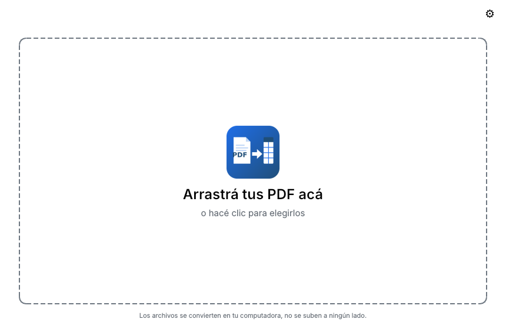
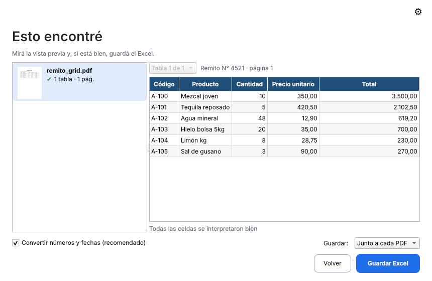
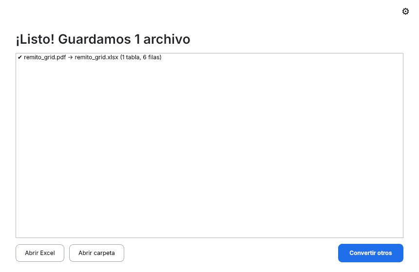

# Conversor PDF a Excel (app de escritorio)

Convertí remitos, facturas, listas de precios, reportes de stock o extractos bancarios en PDF a un
Excel prolijo: tablas con números y fechas de verdad (formato argentino), encabezado fijo, filtros y
lo dudoso marcado en amarillo para revisar. Funciona con PDFs digitales **y escaneados** (hace
reconocimiento de texto, OCR, en castellano e inglés). Todo se procesa **en tu computadora**: los
archivos no se suben a ningún lado.

> La versión anterior, para usar desde el navegador con Google Colab, sigue en el
> [README de la raíz del repo](../README.md).

## Cómo se ve

| Arrastrá | Esto encontré | Listo |
|---|---|---|
|  |  |  |

## Instalación (Windows)

Hay dos formas; las dos sirven para cualquier usuario sin permisos de administrador.

**Opción A — Instalador (recomendada)**

1. Bajá `ConversorPDFaExcel-setup-<versión>.exe` desde la página de *Releases* del repo.
2. Ejecutalo. Se instala solo para tu usuario (no pide contraseña de administrador) y crea el acceso
   directo "Conversor PDF a Excel" en el menú Inicio.
3. Opcional: dejá marcada la casilla **"Agregar a Enviar a"** para poder hacer clic derecho sobre un
   PDF → *Enviar a* → *Conversor PDF a Excel*.

Para actualizar, bajá el setup nuevo y ejecutalo encima: no hace falta desinstalar nada.

**Opción B — Zip portable (sin instalar)**

1. Bajá `ConversorPDFaExcel-portable-<versión>.zip`.
2. Descomprimilo en cualquier carpeta (por ejemplo `Documentos\Conversor PDF a Excel`) o en un pendrive.
3. Abrí `ConversorPDFaExcel.exe` que está adentro.

**macOS / Linux**: se usa el mismo código con el Tesseract del sistema (`brew install tesseract
tesseract-lang` / `sudo apt install tesseract-ocr tesseract-ocr-spa`). Hay un `.dmg` para macOS en
*Releases*; en Linux se corre desde el código fuente (ver "Para desarrolladores").

### Si Windows muestra "Windows protegió tu PC" (SmartScreen)

Pasa con cualquier programa nuevo que todavía no tiene firma digital conocida: no significa que tenga
un virus. Para seguir:

1. Tocá **Más información** (el link chico debajo del texto).
2. Tocá **Ejecutar de todas formas**.

Solo aparece la primera vez que abrís cada versión.

## Cómo se usa (3 pasos)

1. **Arrastrá** uno o varios PDF a la ventana (o hacé clic para elegirlos; también podés arrastrar una
   carpeta entera).
2. Mirá **"Esto encontré"**: a la izquierda cada archivo con cuántas tablas y páginas tiene; a la derecha
   una vista previa de la tabla. La única opción es "Convertir números y fechas (recomendado)": dejala
   marcada salvo que quieras todo como texto.
3. Tocá **Guardar Excel**. Se guarda un `.xlsx` por PDF, al lado del PDF (o en la carpeta que elijas).
   Nunca pisa un archivo que ya existe: si hay un `remito.xlsx`, crea `remito (2).xlsx`.

Al terminar podés **Abrir Excel**, **Abrir carpeta** o **Convertir otros**. Si un archivo falla (está
dañado o protegido con contraseña), los demás se convierten igual y la app te dice cuál quedó afuera.

### Qué hay dentro del Excel

- **Una hoja por tabla**, con el título que tenía en el PDF (o "Tabla 1", "Tabla 2"…). Si la tabla
  seguía en la página siguiente, se junta en una sola hoja.
- Fila 1 = encabezado fijo con filtros. Importes como números (`1.234,56`), fechas como fechas,
  porcentajes como porcentajes. Los códigos (CUIT, nro. de comprobante, SKU) quedan como texto para
  no perder ceros ni guiones.
- Hoja **"Datos del documento"**: lo que estaba fuera de las tablas (Cliente, Fecha, CUIT, textos sueltos).
- Hoja **"Revisión"** (solo si hace falta): lista de las celdas marcadas en amarillo.

### Qué significan las celdas amarillas

Una celda amarilla es algo que la app **no pudo interpretar con seguridad** como número o fecha
(por ejemplo "s/d", "24 aprox." o un número que el escaneo leyó mal). Queda escrita tal cual venía
en el PDF, con un comentario "Revisar". La app nunca inventa un valor: si hay dudas, te lo marca y
lo decidís vos en Excel. Si el PDF era un escaneo, la hoja "Revisión" avisa que los números pueden
tener errores de lectura; conviene chequear los totales.

### Consejos para escaneos

- Escaneá derecho, nítido y a 200 dpi o más. Las tablas con bordes se leen mejor que las que no tienen líneas.
- Las fotos de celular se convierten, pero con más celdas amarillas.
- Si el PDF tiene texto pero sale con caracteres raros, en el engranaje activá "Forzar OCR en todas las páginas".

## Si algo falla

- Los mensajes de error están en castellano y dicen qué hacer (cerrar el Excel abierto, elegir otra
  carpeta, ingresar la contraseña del PDF…).
- Para reportar un problema, mandá el PDF (si se puede) y el **log**:
  - Windows: `%LOCALAPPDATA%\ConversorPDFaExcel\Logs\app.log`
    (pegá esa ruta en la barra del Explorador).
  - macOS: `~/Library/Logs/ConversorPDFaExcel/app.log`
  - Linux: `~/.local/state/ConversorPDFaExcel/log/app.log`
- La hoja oculta "Origen" del Excel (se puede mostrar desde el engranaje) dice qué estrategia se usó en
  cada tabla y con qué versión de la app; ayuda a diagnosticar.
- Los escaneos ya leídos con OCR quedan en una **caché** para no repetir el trabajo si volvés a convertir
  el mismo PDF: `%LOCALAPPDATA%\ConversorPDFaExcel\Cache\ocr` (Windows), `~/Library/Caches/ConversorPDFaExcel/ocr`
  (macOS) o `~/.cache/ConversorPDFaExcel/ocr` (Linux). Se limpia sola (máximo 500 MB, nada de más de 30
  días) y se puede borrar a mano sin riesgo.

## Para desarrolladores

```bash
cd desktop
python -m venv .venv && . .venv/bin/activate      # Windows: .venv\Scripts\activate
pip install -e ".[dev]"
QT_QPA_PLATFORM=offscreen pytest                   # tests
ruff check src tests && mypy src                   # lint + tipos
python -m pdf2excel                                # abre la app
python -m pdf2excel archivo.pdf                    # modo línea de comandos
```

El diseño completo (arquitectura, pipeline de extracción, formato del Excel, UI, empaquetado) está en
[`docs/DESIGN.md`](docs/DESIGN.md). Stack: Python 3.13, PySide6 (Qt Widgets), PyMuPDF 2.0 +
pymupdf-layout (modelo de layout ONNX), OpenCV, Tesseract 5 (OCR), openpyxl. El empaquetado para
Windows se hace con PyInstaller + Inno Setup desde GitHub Actions.

## Licencia

Esta app (`desktop/`) se distribuye bajo la **GNU Affero General Public License v3.0 o posterior**
(ver [`LICENSE`](LICENSE)), porque usa PyMuPDF, que es AGPL. Podés usarla, copiarla y modificarla
libremente; si distribuís una versión modificada, tenés que publicar el código fuente con la misma licencia.
